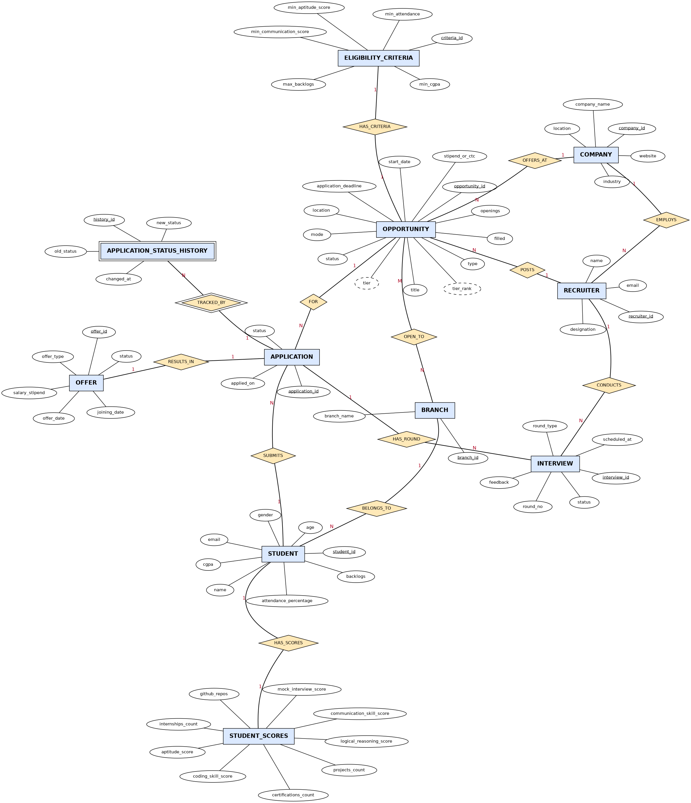

# Campus Internship & Placement Recruitment System (CIPRS)
## Comprehensive Technical Documentation & Architecture Report

---

## 1. Problem Statement

Modern campus placement management processes in higher education institutions face operational bottlenecks due to disparate workflows, manual eligibility verification, and high administrative overhead. Typical challenges include:
- **Inequitable Opportunity Distribution**: High-performing candidates frequently secure multiple entry-tier offers and continue applying to lower-tier roles, reducing interview opportunities for peers ("offer hoarding").
- **Eligibility Verification Delays**: Placement officers manually cross-reference academic criteria (CGPA, active backlogs, mandatory attendance) and assessment performance across disparate spreadsheets.
- **Concurrency & Race Conditions**: Simultaneous status updates and hiring quota management during on-campus recruitment drives risk over-allocating fixed job openings.
- **Lack of Intelligent Discovery**: Students are overwhelmed by broad opportunity listings without personalized insights into emerging roles or peer engagement patterns.
- **Database Scalability & Cache Pressure**: Intensive read traffic on opportunity overview screens during peak recruitment drives degrades relational database throughput.

---

## 2. Objectives

The primary objectives of the Campus Internship & Placement Recruitment System are:
1. **Enforce Transactional Integrity & Automated Rules**: Implement database-level tier locks and ACID-compliant stored routines to automate eligibility filtering, slot allocation, and cascading offer acceptances.
2. **Polyglot Persistence**: Combine the transactional reliability of MySQL 8.0, the graph relationship capabilities of Neo4j, and the sub-millisecond retrieval of Redis.
3. **Graph-Powered Peer Recommendations**: Provide collaborative filtering to discover roles based on shared peer application activity.
4. **Resilient High-Throughput Caching**: Mitigate database load during recruitment drives using Redis caching with automatic event-driven invalidation and transparent MySQL failover.
5. **Auditable Lifecycle Tracking**: Ensure complete immutability and historical auditing of student applications across all stages (`Applied` $\rightarrow$ `Shortlisted` $\rightarrow$ `Interview` $\rightarrow$ `Selected` / `Rejected`).

---

## 3. Scope

### In Scope
- Three distinct role-based portals: **Student**, **Recruiter**, and **Placement Officer**.
- Automated evaluation of academic prerequisites (minimum CGPA, maximum backlogs, minimum attendance percentage) and skill assessment scores.
- Dynamic full-time CTC tier classification (`Dream`, `Tier 1`, `Tier 2`, `Tier 3`) with institutional "Tier Lock" policies enforced via triggers.
- Multi-round interview scheduling with recruiter feedback logs.
- Automated slot reservation (`filled` count) upon candidate selection and automatic slot release upon offer decline.
- Graph-based collaborative filtering recommendations and student private bookmarks with inline notes.
- In-memory Redis caching with automated TTL and event-driven invalidation.

### Out of Scope
- External payment gateway integration for placement registration fees.
- Real-time video conferencing for technical interviews (external meeting links are recorded instead).
- Native mobile applications (the platform provides a fully responsive mobile-first web interface).

---

## 4. Functional Requirements

### 4.1 Authentication & Session Management
- **FR-01**: Secure role-based authentication (`student`, `recruiter`, `officer`) using SHA-256 password hashing.
- **FR-02**: Tamper-proof HMAC-SHA256 signed session cookies with 8-hour expiration and `HttpOnly`, `SameSite=Lax` security flags.

### 4.2 Student Portal
- **FR-03**: Real-time display of branch-specific eligible opportunities, filtered against active institutional deadlines.
- **FR-04**: Automated validation on application submission checking CGPA, backlogs, attendance, assessment scores, and tier lock status.
- **FR-05**: Application tracking dashboard displaying real-time status transitions and interview schedules.
- **FR-06**: Offer acceptance workflow: Accepting a full-time offer automatically withdraws all other pending applications at or below that tier.
- **FR-07**: Interactive "Recommended for you" panel powered by Neo4j collaborative filtering.
- **FR-08**: Bookmark management with inline note editing (maximum 200 characters) and removal capabilities.

### 4.3 Recruiter Portal
- **FR-09**: Posting new internship and full-time opportunities with custom eligibility criteria and branch targeting.
- **FR-10**: Candidate pipeline management: Reviewing applicant profiles, viewing skill scores, and transitioning statuses (`Applied` $\rightarrow$ `Shortlisted` $\rightarrow$ `Interview` $\rightarrow$ `Selected` / `Rejected`).
- **FR-11**: Multi-round interview coordination with interviewer designation and feedback capture.

### 4.4 Placement Officer Portal
- **FR-12**: Moderation queue: Reviewing, approving, or rejecting newly posted opportunities before they become visible to students.
- **FR-13**: Placement analytics dashboard: Branch-wise placement percentages, median salary metrics, and recruiting company distributions.

---

## 5. Entity-Relationship (ER) Diagram

The system's relational data model follows a normalized design centered on institutional recruitment workflows.


*(Fallback reference if viewed from nested directory: `../er_diagram_chen.png`)*

### Key Entities and Relationships
- **Student (1:1) Student Scores**: Detailed assessment metrics (coding, aptitude, logical reasoning, communication, mock interview).
- **Branch (1:N) Student**: Academic departmental association.
- **Company (1:N) Recruiter**: Corporate organizational hierarchy.
- **Company (1:N) Opportunity**: Corporate recruitment drives.
- **Opportunity (M:N) Branch**: Explicit branch eligibility mapping via `opportunity_branch`.
- **Opportunity (1:1) Eligibility Criteria**: Strict academic and skill thresholds for applicants.
- **Student (M:N) Opportunity via Application**: Distinct student application instances with full state transitions.
- **Application (1:N) Application Status History**: Immutable audit log of lifecycle progression.
- **Application (1:N) Interview**: Multiple technical/HR rounds per applicant.
- **Application (1:1) Offer**: Formal job/internship offer generation upon candidate selection.

---

## 6. Relational Schema

```
branch (
    branch_id INT [PK] [AUTO_INCREMENT],
    branch_name VARCHAR(100) [UNIQUE]
)

student (
    student_id INT [PK] [AUTO_INCREMENT],
    name VARCHAR(100),
    email VARCHAR(150) [UNIQUE],
    age SMALLINT,
    gender VARCHAR(20),
    cgpa DECIMAL(4,2),
    backlogs SMALLINT,
    attendance_percentage DECIMAL(5,2),
    branch_id INT [FK -> branch.branch_id]
)

student_scores (
    student_id INT [PK, FK -> student.student_id],
    coding_skill_score DECIMAL(5,2),
    aptitude_score DECIMAL(5,2),
    logical_reasoning_score DECIMAL(5,2),
    communication_skill_score DECIMAL(5,2),
    mock_interview_score DECIMAL(5,2),
    certifications_count SMALLINT,
    projects_count SMALLINT,
    github_repos SMALLINT,
    internships_count SMALLINT
)

company (
    company_id INT [PK] [AUTO_INCREMENT],
    company_name VARCHAR(150) [UNIQUE],
    industry VARCHAR(100),
    website VARCHAR(255),
    location VARCHAR(150)
)

recruiter (
    recruiter_id INT [PK] [AUTO_INCREMENT],
    company_id INT [FK -> company.company_id],
    name VARCHAR(100),
    email VARCHAR(150) [UNIQUE],
    designation VARCHAR(100)
)

users (
    user_id INT [PK] [AUTO_INCREMENT],
    username VARCHAR(50) [UNIQUE],
    password_hash CHAR(64),
    role VARCHAR(20),
    student_id INT [FK -> student.student_id, UNIQUE, NULLABLE],
    recruiter_id INT [FK -> recruiter.recruiter_id, UNIQUE, NULLABLE]
)

opportunity (
    opportunity_id INT [PK] [AUTO_INCREMENT],
    company_id INT [FK -> company.company_id],
    recruiter_id INT [FK -> recruiter.recruiter_id],
    title VARCHAR(150),
    type VARCHAR(30),
    stipend_or_ctc DECIMAL(12,2),
    location VARCHAR(150),
    mode VARCHAR(30),
    start_date DATE,
    application_deadline DATE,
    status VARCHAR(30),
    approval_status VARCHAR(20),
    openings SMALLINT,
    filled SMALLINT,
    tier VARCHAR(10) [STORED GENERATED],
    tier_rank TINYINT [STORED GENERATED],
    description TEXT
)

opportunity_branch (
    opportunity_id INT [PK, FK -> opportunity.opportunity_id],
    branch_id INT [PK, FK -> branch.branch_id]
)

eligibility_criteria (
    criteria_id INT [PK] [AUTO_INCREMENT],
    opportunity_id INT [FK -> opportunity.opportunity_id, UNIQUE],
    min_cgpa DECIMAL(4,2),
    max_backlogs SMALLINT,
    min_attendance DECIMAL(5,2),
    min_aptitude_score DECIMAL(5,2),
    min_communication_score DECIMAL(5,2)
)

application (
    application_id INT [PK] [AUTO_INCREMENT],
    student_id INT [FK -> student.student_id],
    opportunity_id INT [FK -> opportunity.opportunity_id],
    applied_on TIMESTAMP,
    status VARCHAR(30),
    [UNIQUE(student_id, opportunity_id)]
)

application_status_history (
    history_id INT [PK] [AUTO_INCREMENT],
    application_id INT [FK -> application.application_id],
    old_status VARCHAR(30),
    new_status VARCHAR(30),
    changed_at TIMESTAMP
)

interview (
    interview_id INT [PK] [AUTO_INCREMENT],
    application_id INT [FK -> application.application_id],
    interviewer_id INT [FK -> recruiter.recruiter_id],
    round_no SMALLINT,
    round_type VARCHAR(50),
    scheduled_at TIMESTAMP,
    status VARCHAR(30),
    feedback TEXT,
    [UNIQUE(application_id, round_no)]
)

offer (
    offer_id INT [PK] [AUTO_INCREMENT],
    application_id INT [FK -> application.application_id, UNIQUE],
    offer_type VARCHAR(30),
    salary_stipend DECIMAL(12,2),
    offer_date DATE,
    joining_date DATE,
    status VARCHAR(30)
)
```

---

## 7. Database Choice & Justification

The platform employs a **Polyglot Persistence Architecture**, utilizing three specialized storage engines:

```
+---------------------------------------------------------------------------------------+
|                                    Client Browser                                     |
+---------------------------------------------------------------------------------------+
                                           |
                                           v
+---------------------------------------------------------------------------------------+
|                               Next.js 14 Web Server                                   |
|                             (App Router Server Actions)                               |
+---------------------------------------------------------------------------------------+
         |                                 |                                 |
         | Read/Write Relational           | 60s Query Cache                 | Graph Traversal
         v                                 v                                 v
+------------------+             +-------------------+             +--------------------+
|    MySQL 8.0     |             |      Redis 7      |             |      Neo4j 5       |
|  Transactional   |             | In-Memory Caching |             | Graph Engine       |
|  Core (ACID)     |             | & Invalidation    |             | & Recommendations  |
+------------------+             +-------------------+             +--------------------+
```

### 7.1 MySQL 8.0 (Transactional Relational Core)
- **Role**: Primary System of Record (SoR) for all transactional business logic.
- **Justification**:
  1. **ACID Guarantees**: Essential for maintaining strict financial and placement offer states. Preventing duplicate offers or corrupted slot tallies requires atomic transactions.
  2. **Row-Level Locking & Isolation**: Critical for preventing concurrency anomalies during candidate selection drives (`SELECT ... FOR UPDATE`).
  3. **Complex Triggers & Routines**: Business policies (tier-lock rules, automatic audit logging, cascading offer withdrawals) are enforced directly within the database engine, ensuring integrity across any access client.
  4. **Generated Stored Columns**: Automatically evaluates salary tiers (`Dream`, `Tier 1`, `Tier 2`, `Tier 3`) and numerical rank values directly on disk without requiring application-level compute overhead.

### 7.2 Neo4j (Graph Relationship & Recommendation Engine)
- **Role**: Peer-based collaborative filtering recommendations and student saved bookmarks.
- **Justification**:
  1. **Efficient Multi-Hop Traversals**: Collaborative filtering queries traverse a 4-edge cycle: `(me)-[:APPLIED]->(common)<-[:APPLIED]-(peer)-[:APPLIED]->(rec)`. In relational SQL, this requires 4-table self-joins that become computationally expensive as rows scale into millions. In Neo4j, pointer-chasing graph traversal executes in milliseconds.
  2. **Decoupled User Personalization**: Private bookmarks with notes (`(:Student)-[:SAVED {note, at}]->(:Opportunity)`) are kept separate from the normalized transactional schema, avoiding schema bloat.

### 7.3 Redis (High-Performance In-Memory Cache)
- **Role**: Sub-millisecond query caching for the student dashboard.
- **Justification**:
  1. **Load Shedding**: The student home screen executes a complex multi-join view (`v_opportunity_overview`) aggregated with branch eligibility filters. Caching results with a 60-second TTL prevents repeated table scans.
  2. **Event-Driven Invalidation**: Recruiter opportunity submissions and officer approval decisions immediately purge matching cache keys (`student:opps:*`), eliminating stale reads.
  3. **Resilient Non-Blocking Fallback**: Designed with transparent failover; if the Redis container is unreachable, the system automatically falls back to MySQL without crashing.

---

## 8. Data Dictionary

### Table: `branch`
| Column | Type | Constraints | Description |
|---|---|---|---|
| `branch_id` | INT | PK, Auto Increment | Unique departmental identifier |
| `branch_name` | VARCHAR(100) | NOT NULL, UNIQUE | Department title (e.g., Computer Science) |

### Table: `student`
| Column | Type | Constraints | Description |
|---|---|---|---|
| `student_id` | INT | PK, Auto Increment | Unique student registration ID |
| `name` | VARCHAR(100) | NOT NULL | Full name of the candidate |
| `email` | VARCHAR(150) | NOT NULL, UNIQUE | Institutional email address |
| `age` | SMALLINT | CHECK (age > 0) | Candidate age in years |
| `gender` | VARCHAR(20) | CHECK (gender IN ('Male','Female','Other')) | Candidate gender identity |
| `cgpa` | DECIMAL(4,2) | CHECK (cgpa BETWEEN 0 AND 10) | Cumulative Grade Point Average |
| `backlogs` | SMALLINT | DEFAULT 0, CHECK (backlogs >= 0) | Number of active uncleared academic backlogs |
| `attendance_percentage` | DECIMAL(5,2) | CHECK (attendance BETWEEN 0 AND 100) | Course attendance percentage |
| `branch_id` | INT | FK -> `branch(branch_id)` | Academic department reference |

### Table: `student_scores`
| Column | Type | Constraints | Description |
|---|---|---|---|
| `student_id` | INT | PK, FK -> `student(student_id)` | Student reference (1:1 relationship) |
| `coding_skill_score` | DECIMAL(5,2) | CHECK (0-100) | Technical coding assessment score |
| `aptitude_score` | DECIMAL(5,2) | CHECK (0-100) | Quantitative aptitude benchmark |
| `logical_reasoning_score` | DECIMAL(5,2) | CHECK (0-100) | Logical problem solving score |
| `communication_skill_score` | DECIMAL(5,2) | CHECK (0-100) | Verbal and written assessment score |
| `mock_interview_score` | DECIMAL(5,2) | CHECK (0-100) | Preparatory interview grade |
| `certifications_count` | SMALLINT | DEFAULT 0 | Verified industry credentials count |
| `projects_count` | SMALLINT | DEFAULT 0 | Completed software projects count |
| `github_repos` | SMALLINT | DEFAULT 0 | Public code repositories count |
| `internships_count` | SMALLINT | DEFAULT 0 | Completed prior internships count |

### Table: `company`
| Column | Type | Constraints | Description |
|---|---|---|---|
| `company_id` | INT | PK, Auto Increment | Unique employer identifier |
| `company_name` | VARCHAR(150) | NOT NULL, UNIQUE | Legal corporate organization name |
| `industry` | VARCHAR(100) | NULLABLE | Industry sector (e.g., Software, Aerospace) |
| `website` | VARCHAR(255) | NULLABLE | Corporate URL |
| `location` | VARCHAR(150) | NULLABLE | Headquarters / office location |

### Table: `recruiter`
| Column | Type | Constraints | Description |
|---|---|---|---|
| `recruiter_id` | INT | PK, Auto Increment | Unique recruiter profile ID |
| `company_id` | INT | NOT NULL, FK -> `company(company_id)` | Affiliated hiring company |
| `name` | VARCHAR(100) | NOT NULL | Recruiter representative name |
| `email` | VARCHAR(150) | NOT NULL, UNIQUE | Corporate recruiter email address |
| `designation` | VARCHAR(100) | NULLABLE | Title (e.g., Lead Talent Acquisition) |

### Table: `users`
| Column | Type | Constraints | Description |
|---|---|---|---|
| `user_id` | INT | PK, Auto Increment | User authentication account ID |
| `username` | VARCHAR(50) | NOT NULL, UNIQUE | Login handle |
| `password_hash` | CHAR(64) | NOT NULL | Unsalted SHA-256 hash representation |
| `role` | VARCHAR(20) | CHECK ('student','recruiter','officer') | Authorization role |
| `student_id` | INT | NULLABLE, UNIQUE, FK -> `student` | Associated student reference if role is student |
| `recruiter_id` | INT | NULLABLE, UNIQUE, FK -> `recruiter` | Associated recruiter reference if role is recruiter |

### Table: `opportunity`
| Column | Type | Constraints | Description |
|---|---|---|---|
| `opportunity_id` | INT | PK, Auto Increment | Unique opportunity identifier |
| `company_id` | INT | NOT NULL, FK -> `company` | Hiring entity |
| `recruiter_id` | INT | NOT NULL, FK -> `recruiter` | Opportunity creator |
| `title` | VARCHAR(150) | NOT NULL | Role designation title |
| `type` | VARCHAR(30) | CHECK ('Internship','Full-time') | Recruitment category |
| `stipend_or_ctc` | DECIMAL(12,2) | CHECK (>= 0) | Annual CTC or monthly stipend in INR |
| `location` | VARCHAR(150) | NULLABLE | Work deployment location |
| `mode` | VARCHAR(30) | CHECK ('Onsite','Remote','Hybrid') | Working arrangement |
| `start_date` | DATE | NULLABLE | Anticipated date of joining |
| `application_deadline` | DATE | NOT NULL | Last date for application submission |
| `status` | VARCHAR(30) | CHECK ('Open','Closed') | Application intake status |
| `approval_status` | VARCHAR(20) | DEFAULT 'Pending', CHECK ('Pending','Approved','Rejected') | Placement cell moderation state |
| `openings` | SMALLINT | DEFAULT 1, CHECK (openings >= 1) | Available vacancy quota |
| `filled` | SMALLINT | DEFAULT 0, CHECK (filled <= openings) | Reserved/accepted candidate slots |
| `tier` | VARCHAR(10) | STORED GENERATED | Derived tier category (Dream, Tier 1, 2, 3) |
| `tier_rank` | TINYINT | STORED GENERATED | Numerical tier hierarchy (1 to 4) |
| `description` | TEXT | NULLABLE | Full job description text for search indexing |

### Table: `opportunity_branch`
| Column | Type | Constraints | Description |
|---|---|---|---|
| `opportunity_id` | INT | PK, FK -> `opportunity` | Opportunity reference |
| `branch_id` | INT | PK, FK -> `branch` | Eligible academic branch |

### Table: `eligibility_criteria`
| Column | Type | Constraints | Description |
|---|---|---|---|
| `criteria_id` | INT | PK, Auto Increment | Unique criteria entity ID |
| `opportunity_id` | INT | NOT NULL, UNIQUE, FK -> `opportunity` | Target opportunity reference (1:1) |
| `min_cgpa` | DECIMAL(4,2) | CHECK (0-10) | Minimum qualifying CGPA |
| `max_backlogs` | SMALLINT | CHECK (>= 0) | Maximum permissible active backlogs |
| `min_attendance` | DECIMAL(5,2) | CHECK (0-100) | Minimum percentage attendance required |
| `min_aptitude_score` | DECIMAL(5,2) | CHECK (0-100) | Cutoff score for aptitude test |
| `min_communication_score`| DECIMAL(5,2) | CHECK (0-100) | Cutoff score for communication test |

### Table: `application`
| Column | Type | Constraints | Description |
|---|---|---|---|
| `application_id` | INT | PK, Auto Increment | Unique application transaction record ID |
| `student_id` | INT | NOT NULL, FK -> `student` | Applicant student reference |
| `opportunity_id` | INT | NOT NULL, FK -> `opportunity` | Selected opportunity reference |
| `applied_on` | TIMESTAMP | DEFAULT CURRENT_TIMESTAMP | Submission timestamp |
| `status` | VARCHAR(30) | CHECK ('Applied','Shortlisted','Interview','Selected','Rejected','Withdrawn') | Current candidate progression state |

### Table: `application_status_history`
| Column | Type | Constraints | Description |
|---|---|---|---|
| `history_id` | INT | PK, Auto Increment | Unique historical event ID |
| `application_id` | INT | NOT NULL, FK -> `application` | Target application reference |
| `old_status` | VARCHAR(30) | NULLABLE | Previous status state |
| `new_status` | VARCHAR(30) | NOT NULL | Updated status state |
| `changed_at` | TIMESTAMP | DEFAULT CURRENT_TIMESTAMP | Audit timestamp |

### Table: `interview`
| Column | Type | Constraints | Description |
|---|---|---|---|
| `interview_id` | INT | PK, Auto Increment | Unique scheduled interview session ID |
| `application_id` | INT | NOT NULL, FK -> `application` | Target candidate application |
| `interviewer_id` | INT | NOT NULL, FK -> `recruiter` | Conducting evaluator |
| `round_no` | SMALLINT | CHECK (round_no > 0) | Sequential round order |
| `round_type` | VARCHAR(50) | CHECK ('Aptitude','Technical','HR') | Interview format |
| `scheduled_at` | TIMESTAMP | NULLABLE | Interview datetime |
| `status` | VARCHAR(30) | CHECK ('Scheduled','Completed','Cancelled') | Operational status |
| `feedback` | TEXT | NULLABLE | Detailed evaluation comments |

### Table: `offer`
| Column | Type | Constraints | Description |
|---|---|---|---|
| `offer_id` | INT | PK, Auto Increment | Unique offer letter identifier |
| `application_id` | INT | NOT NULL, UNIQUE, FK -> `application`| Associated application reference (1:1) |
| `offer_type` | VARCHAR(30) | CHECK ('Internship','Full-time') | Type of employment offer |
| `salary_stipend` | DECIMAL(12,2) | CHECK (>= 0) | Compensation package figure |
| `offer_date` | DATE | NOT NULL | Generation date of offer |
| `joining_date` | DATE | CHECK (joining_date >= offer_date) | Expected reporting date |
| `status` | VARCHAR(30) | CHECK ('Offered','Accepted','Declined','Withdrawn') | Acceptance status |

---

## 9. Neo4j Graph Data Model

The graph projection complements the relational store by mapping students and opportunities as discrete nodes connected through application and bookmarking relationships:

```
(:Student {id, name, cgpa, branch})
       |                     |
       | [:APPLIED {status}] | [:SAVED {note, at}]
       v                     v
(:Opportunity {id, title, tier, type, company, open})
```

### 9.1 Node Labels & Schema
1. **`:Student`**
   - `id`: Integer (Unique constraint on `Student.id`)
   - `name`: String
   - `cgpa`: Float
   - `branch`: String
2. **`:Opportunity`**
   - `id`: Integer (Unique constraint on `Opportunity.id`)
   - `title`: String
   - `tier`: String (Dream, Tier 1, Tier 2, Tier 3, or null)
   - `type`: String (Full-time or Internship)
   - `company`: String
   - `open`: Boolean (`true` if status='Open' and approval_status='Approved')

### 9.2 Relationship Types
1. **`[:APPLIED {status}]`**
   - Directed from `(:Student)` to `(:Opportunity)`.
   - Records the current application status (`Applied`, `Shortlisted`, `Interview`, `Selected`, `Rejected`, `Withdrawn`).
2. **`[:SAVED {note, at}]`**
   - Directed from `(:Student)` to `(:Opportunity)`.
   - Stores candidate private annotations (`note`) and ISO-8601 creation timestamps (`at`).

---

## 10. Important Queries & Routines

### 10.1 Stored Function: `fn_student_tier_lock` (db/02_routines.sql)
Determines the highest tier rank among a student's accepted full-time offers (0 if none):
```sql
CREATE FUNCTION fn_student_tier_lock(p_student INT) RETURNS TINYINT
READS SQL DATA
BEGIN
    DECLARE v_lock TINYINT;
    SELECT COALESCE(MAX(o.tier_rank), 0) INTO v_lock
    FROM offer f
    JOIN application a ON a.application_id = f.application_id
    JOIN opportunity o ON o.opportunity_id = a.opportunity_id
    WHERE a.student_id = p_student
      AND f.status = 'Accepted'
      AND o.`type` = 'Full-time';
    RETURN v_lock;
END$$
```

### 10.2 Trigger: Tier Lock Enforcement `trg_application_bi` (db/02_routines.sql)
Guarantees database-level enforcement of the institutional tier policy before application insertion:
```sql
CREATE TRIGGER trg_application_bi BEFORE INSERT ON application
FOR EACH ROW
BEGIN
    DECLARE v_type VARCHAR(30);
    DECLARE v_rank TINYINT;
    SELECT `type`, tier_rank INTO v_type, v_rank
    FROM opportunity WHERE opportunity_id = NEW.opportunity_id;
    IF v_type = 'Full-time' AND v_rank <= fn_student_tier_lock(NEW.student_id) THEN
        SIGNAL SQLSTATE '45000'
            SET MESSAGE_TEXT = 'Tier lock: you can only apply to a higher tier than your accepted offer';
    END IF;
END$$
```

### 10.3 Stored Procedure: Automated Application Processing `sp_apply` (db/02_routines.sql)
Validates deadline, approval status, departmental eligibility, and academic cutoffs before inserting:
```sql
CREATE PROCEDURE sp_apply(IN p_student INT, IN p_opp INT)
BEGIN
    DECLARE v_status VARCHAR(30);
    DECLARE v_approval VARCHAR(20);
    DECLARE v_deadline DATE;
    DECLARE v_branch_ok INT DEFAULT 0;
    DECLARE v_eligible INT DEFAULT 0;
    DECLARE EXIT HANDLER FOR 1062
        SIGNAL SQLSTATE '45000' SET MESSAGE_TEXT = 'You have already applied to this opportunity';

    SELECT status, approval_status, application_deadline
      INTO v_status, v_approval, v_deadline
      FROM opportunity WHERE opportunity_id = p_opp;

    IF v_status IS NULL THEN
        SIGNAL SQLSTATE '45000' SET MESSAGE_TEXT = 'Opportunity not found';
    END IF;
    IF v_approval <> 'Approved' OR v_status <> 'Open' OR v_deadline < CURDATE() THEN
        SIGNAL SQLSTATE '45000' SET MESSAGE_TEXT = 'This opportunity is not open for applications';
    END IF;

    SELECT COUNT(*) INTO v_branch_ok
      FROM student s
      JOIN opportunity_branch ob ON ob.branch_id = s.branch_id AND ob.opportunity_id = p_opp
     WHERE s.student_id = p_student;
    IF v_branch_ok = 0 THEN
        SIGNAL SQLSTATE '45000' SET MESSAGE_TEXT = 'Your branch is not eligible for this opportunity';
    END IF;

    SELECT COUNT(*) INTO v_eligible
      FROM student s
      LEFT JOIN student_scores sc ON sc.student_id = s.student_id
      LEFT JOIN eligibility_criteria e ON e.opportunity_id = p_opp
     WHERE s.student_id = p_student
       AND (e.min_cgpa IS NULL OR s.cgpa >= e.min_cgpa)
       AND (e.max_backlogs IS NULL OR s.backlogs <= e.max_backlogs)
       AND (e.min_attendance IS NULL OR s.attendance_percentage >= e.min_attendance)
       AND (e.min_aptitude_score IS NULL OR sc.aptitude_score >= e.min_aptitude_score)
       AND (e.min_communication_score IS NULL OR sc.communication_skill_score >= e.min_communication_score);
    IF v_eligible = 0 THEN
        SIGNAL SQLSTATE '45000' SET MESSAGE_TEXT = 'You do not meet the eligibility criteria';
    END IF;

    INSERT INTO application (student_id, opportunity_id, status) VALUES (p_student, p_opp, 'Applied');
END$$
```

### 10.4 Non-Recursive CTE: Placement Funnel (db/04_advanced_queries.sql)
Aggregates application distribution and conversion rates across opportunity types:
```sql
WITH status_counts AS (
    SELECT 
        o.`type` AS opportunity_type,
        a.status AS application_status,
        COUNT(*) AS application_count
    FROM application a
    JOIN opportunity o ON a.opportunity_id = o.opportunity_id
    GROUP BY o.`type`, a.status
),
type_totals AS (
    SELECT 
        opportunity_type,
        SUM(application_count) AS total_applications
    FROM status_counts
    GROUP BY opportunity_type
)
SELECT 
    sc.opportunity_type,
    sc.application_status,
    sc.application_count,
    tt.total_applications,
    ROUND((sc.application_count / tt.total_applications) * 100, 2) AS percentage
FROM status_counts sc
JOIN type_totals tt ON sc.opportunity_type = tt.opportunity_type
ORDER BY sc.opportunity_type, sc.application_count DESC;
```

### 10.5 Recursive CTE: Stage Progression (db/04_advanced_queries.sql)
Generates sequential hiring milestones and counts distinct candidates reaching each milestone:
```sql
WITH RECURSIVE hiring_stages (stage_order, stage_name) AS (
    SELECT 1 AS stage_order, CAST('Applied' AS CHAR(30)) AS stage_name
    UNION ALL
    SELECT 
        stage_order + 1,
        CASE stage_order + 1
            WHEN 2 THEN CAST('Shortlisted' AS CHAR(30))
            WHEN 3 THEN CAST('Interview' AS CHAR(30))
            WHEN 4 THEN CAST('Selected' AS CHAR(30))
        END
    FROM hiring_stages
    WHERE stage_order < 4
)
SELECT 
    hs.stage_order,
    hs.stage_name,
    COUNT(DISTINCT ash.application_id) AS applications_reached
FROM hiring_stages hs
LEFT JOIN application_status_history ash ON ash.new_status = hs.stage_name
GROUP BY hs.stage_order, hs.stage_name
ORDER BY hs.stage_order;
```

### 10.6 Correlated Subquery: High Academic Performers (db/04_advanced_queries.sql)
Retrieves students performing strictly above their respective department average:
```sql
SELECT 
    s.student_id,
    s.name,
    b.branch_name,
    s.cgpa,
    ROUND((SELECT AVG(s2.cgpa) FROM student s2 WHERE s2.branch_id = s.branch_id), 2) AS branch_avg_cgpa
FROM student s
JOIN branch b ON s.branch_id = b.branch_id
WHERE s.cgpa > (
    SELECT AVG(s2.cgpa)
    FROM student s2
    WHERE s2.branch_id = s.branch_id
)
ORDER BY b.branch_name, s.cgpa DESC, s.student_id;
```

### 10.7 Transaction Management: SAVEPOINT & Partial Rollback (db/04_advanced_queries.sql)
```sql
DELETE FROM branch WHERE branch_name IN ('Robotics & Automation', 'Temporary Trial Branch');

START TRANSACTION;
INSERT INTO branch (branch_name) VALUES ('Robotics & Automation');

SAVEPOINT sp_after_valid_branch;
INSERT INTO branch (branch_name) VALUES ('Temporary Trial Branch');

-- Reverts only the tentative insert, retaining the valid branch
ROLLBACK TO SAVEPOINT sp_after_valid_branch;
COMMIT;

SELECT branch_id, branch_name 
FROM branch 
WHERE branch_name IN ('Robotics & Automation', 'Temporary Trial Branch');
```

---

## 11. System Architecture

The overall system architecture follows a clean 3-tier model with polyglot data persistence:

```
+---------------------------------------------------------------------------------------+
|                                    PRESENTATION LAYER                                 |
|                                                                                       |
|   Next.js 14 App Router (Tailwind CSS, Client UI Panels, Responsive Server Views)    |
|   - /login: Role-based entry with demo credential assistance                          |
|   - /student: Opportunity discovery, recommendations, saved roles, applications       |
|   - /recruiter: Role posting, pipeline status tracking, interview evaluation          |
|   - /officer: Moderation queue, institutional analytics, placement metrics            |
+---------------------------------------------------------------------------------------+
                                           |
                                           v
+---------------------------------------------------------------------------------------+
|                                    APPLICATION LAYER                                  |
|                                                                                       |
|   Next.js Route Handlers & Server Actions (Node.js runtime)                          |
|   - Authentication & Session Verification (HMAC-SHA256 cookies)                       |
|   - /api/graph/route.js: Collaborative filtering & saved bookmarks engine             |
|   - Redis Caching Layer: 60s TTL student opportunity overview with event invalidation |
+---------------------------------------------------------------------------------------+
                                           |
                   +-----------------------+-----------------------+
                   |                                               |
                   v                                               v
+-------------------------------------+         +-------------------------------------+
|        RELATIONAL PERSISTENCE       |         |          GRAPH PERSISTENCE          |
|                                     |         |                                     |
|  MySQL 8.0 (InnoDB Engine)          |         |  Neo4j 5+ (Bolt Protocol)           |
|  - Relational Integrity & PK/FK     |         |  - Labeled Property Graph           |
|  - Triggers & Tier Locks            |         |  - Cypher Query Language            |
|  - Stored Procedures (ACID)         |         |  - Sub-second Recommendation Hops   |
|  - Full-Text Search Indexes         |         +-------------------------------------+
+-------------------------------------+                            |
                   ^                                               |
                   |                                               v
+-------------------------------------+         +-------------------------------------+
|          IN-MEMORY CACHE            |         |             SYNC ENGINE             |
|                                     |         |                                     |
|  Redis 7 (Standalone / Docker)      |         |  scripts/sync_neo4j.mjs             |
|  - Key-Value Cache Store            |<--------|  - Periodic/Batch ETL pipeline      |
|  - Auto-Expiry TTL (60s)            |         |  - Maps MySQL rows to Graph Nodes   |
|  - Fail-safe fallback to MySQL      |         |  - Generates APPLIED relationships  |
+-------------------------------------+         +-------------------------------------+
```

---

## 12. Testing Results & Verification Matrix

The test suite covers database constraints, triggers, concurrency controls, API security, graph traversals, and caching failover mechanisms:

| Test ID | Test Scenario | Input / Action | Expected Result | Actual Outcome | Status |
|:---:|---|---|---|---|:---:|
| **TC-01** | Apply with Ineligible CGPA | `CALL sp_apply(student_id=23, opp=2)` (Student CGPA 5.59 vs cutoff 7.50) | Execution fails; custom exception raised | Error 45000: `"You do not meet the eligibility criteria"` | **PASS** |
| **TC-02** | Apply with Ineligible Branch | `CALL sp_apply(student_id=4, opp=2)` (Civil student applying to CS-only role) | Execution fails; branch verification fails | Error 45000: `"Your branch is not eligible for this opportunity"` | **PASS** |
| **TC-03** | Apply with Excessive Backlogs | `CALL sp_apply(student_id=3, opp=10)` (Student with 2 backlogs vs max 0 permitted) | Rejection via eligibility criteria evaluation | Error 45000: `"You do not meet the eligibility criteria"` | **PASS** |
| **TC-04** | Duplicate Application Prevention | Student 1 submits identical application for Opportunity 1 twice | Unique constraint `(student_id, opportunity_id)` blocks insert | Error 45000: `"You have already applied to this opportunity"` | **PASS** |
| **TC-05** | Full-Time Tier Lock Enforcement | Candidate holding an Accepted Tier 1 offer applies to a Tier 2 full-time role | Trigger `trg_application_bi` signals tier violation | Error 45000: `"Tier lock: you can only apply to a higher tier than your accepted offer"` | **PASS** |
| **TC-06** | Internship Exemption from Tier Lock | Candidate holding an Accepted Dream offer applies to an Internship | Application succeeds without trigger restriction | Successfully inserted into `application` table | **PASS** |
| **TC-07** | Last-Slot Concurrency Protection | Two recruiters simultaneously select candidates when `slots_left = 1` | `FOR UPDATE` serializes updates; second candidate is rejected | First candidate receives Offer; second receives Error 45000: `"No openings left for this opportunity"` | **PASS** |
| **TC-08** | Full-Time Offer Acceptance Cascade | Candidate executes `sp_respond_offer(offer_id, 1)` | Auto-withdraws lower tier applications; declines lower offers and decrements `filled` | Other applications updated to `Withdrawn`; lower offers set to `Declined`; quota released | **PASS** |
| **TC-09** | Role-Based Access Control | HTTP request to `/api/graph?view=recommend` without session cookie | Endpoint blocks request and returns 401 Unauthorized | HTTP 401 Unauthorized `{"error": "Unauthorized"}` | **PASS** |
| **TC-10** | Recruiter Access to Student Endpoints | HTTP request to `/api/graph` using recruiter session cookie | Session validator restricts execution to student role | HTTP 401 Unauthorized `{"error": "Unauthorized"}` | **PASS** |
| **TC-11** | Graph Collaborative Filtering | Authenticated student queries `GET /api/graph?view=recommend` | Returns top 5 open peer opportunities ranked by shared peer count | Returned 5 recommendations with shared peer metrics (14, 6, 5, 5, 4 peers) | **PASS** |
| **TC-12** | Graph Bookmark Lifecycle (POST, PATCH, DELETE) | Create saved opportunity, edit note (120 chars), and delete | Relationship merged with timestamp, note modified, relationship deleted | POST returns 200, PATCH updates note, DELETE removes relationship | **PASS** |
| **TC-13** | Redis Cache Invalidation on Role Creation | Recruiter posts role via `postOpportunity`; officer approves | Event handler calls `invalidatePattern('student:opps:*')` | Redis keys matching pattern deleted; next student fetch queries MySQL freshly | **PASS** |
| **TC-14** | Redis Outage Transparent Fallback | Redis service stopped; student accesses `/student` dashboard | System catches connection failure and fetches from MySQL without throwing 500 | Dashboard loads successfully with HTTP 200 via direct MySQL query | **PASS** |

---

## 13. UI Walkthrough & Application Pages

### 13.1 Sign-In Screen
[screenshot: Sign-in page with demo accounts helper and flash alerts]

### 13.2 Student Portal - Opportunities & Recommendation Feed
[screenshot: Student home showing 'Recommended for you' cards, 'Saved Opportunities' with inline note editor, and branch-eligible opportunities table]

### 13.3 Student Portal - Applications & Offer Management
[screenshot: Student applications view displaying status badges, interview feedback, and offer acceptance buttons with tier-lock notices]

### 13.4 Recruiter Portal - Opportunity Submission & Candidate Pipeline
[screenshot: Recruiter dashboard showing posted roles, applicant candidate lists, and status transition action controls]

### 13.5 Placement Officer Portal - Moderation & Institutional Analytics
[screenshot: Placement officer dashboard with pending opportunity moderation cards and branch-wise placement metrics]

---

## 14. Conclusion & Future Enhancements

### 14.1 Summary of Contributions
The Campus Internship & Placement Recruitment System provides a production-grade blueprint for modern institutional hiring management. By adopting a **polyglot persistence paradigm**, the platform ensures:
- Absolute data consistency and zero concurrency anomalies on financial offers and hiring quotas through MySQL stored procedures and row-level locks.
- High-relevance, sub-second peer recommendations via Cypher multi-hop graph algorithms in Neo4j.
- Low-latency response times during peak recruitment traffic via Redis in-memory caching with graceful MySQL fallback.

### 14.2 Future Enhancements
1. **Resume Embedding & Semantic Search**: Integrate vector indexes (e.g., pgvector or Neo4j Vector Index) to match candidate PDF resumes against unstructured job descriptions using embedding similarities.
2. **Automated Interview Slot Self-Scheduling**: Enable shortlisted students to select from interviewer availability calendars with automatic Google Calendar / Microsoft Teams webhook integration.
3. **Institutional WhatsApp / SMS Gateway**: Configure real-time SMS / WhatsApp notifications for immediate interview callouts and offer release notifications.
4. **Alumni Mentorship Graph**: Expand the Neo4j graph model to incorporate alumni mentors (`(:Alumni)-[:WORKS_AT]->(:Company)` and `(:Alumni)-[:MENTORS]->(:Student)`), creating mentorship pathways alongside recruitment drives.
